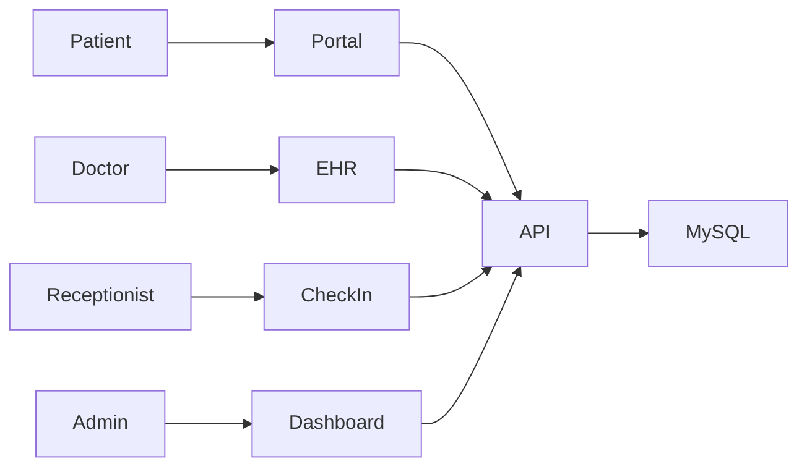

# Project Overview

## Business Problem
HospitalManagement is a hospital management platform covering patient care, clinical workflows, pharmacy, billing, staff operations, telemedicine, analytics, and administration.

## Scope
The repository contains a FastAPI modular monolith, a React/TypeScript frontend, database schema/seed SQL, infrastructure manifests, and tests.

## User Roles
- Admin: system administration and management.
- Doctor: clinical care and EHR.
- Receptionist: check-in, scheduling, patient intake.
- Patient: portal and appointments.

## Feature Status
Implemented modules include patient, appointment, EHR, pharmacy, billing, insurance, staff, department, telemedicine, analytics, and 100+ additional domain modules. Many modules use in-memory repositories and are not yet persisted to MySQL.

## Known Limitations
- Database migrations are placeholder files.
- 111 integration tests require live MySQL.
- Frontend feature modules are registered but navigation is minimal.
- Some modules are boilerplate and require domain-specific validation.

## Mermaid Use Case

