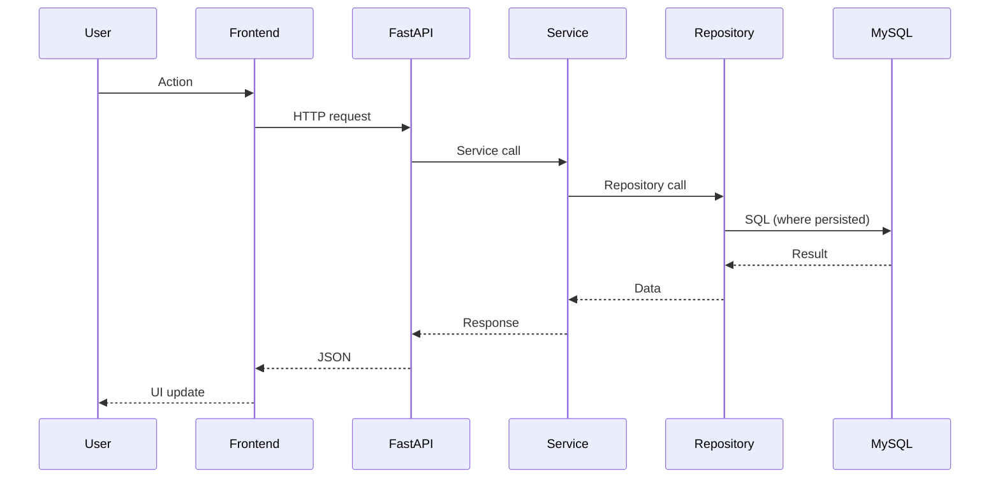

# System Architecture

## High-Level Architecture
Frontend (React/Vite) communicates with Backend (FastAPI) over REST/JSON. Backend uses SQLAlchemy async to MySQL. In-memory repositories are used by many modules.

## Entry Points
- Backend: `backend/main.py`
- Frontend: `frontend/src/main.tsx` (Vite entry)
- Config: `backend/core/config.py`

## Backend Modules
Each module under `backend/modules/<name>/` contains:
- `api.py`: FastAPI router under `/{name}` (or domain-specific prefix)
- `service.py`: business logic
- `repository.py`: in-memory data access
- `schemas.py`: Pydantic models
- `models.py`: SQLAlchemy models where applicable

## Frontend
Feature folders under `frontend/src/features/<name>/` contain types, API client, React Query hooks, and pages.

## Request Lifecycle

## Authentication
JWT tokens with issuer/audience validation and RBAC. Passwords hashed with Argon2.

## Deployment
Docker, Kubernetes, Helm, and Terraform assets are provided under `infra/`.
