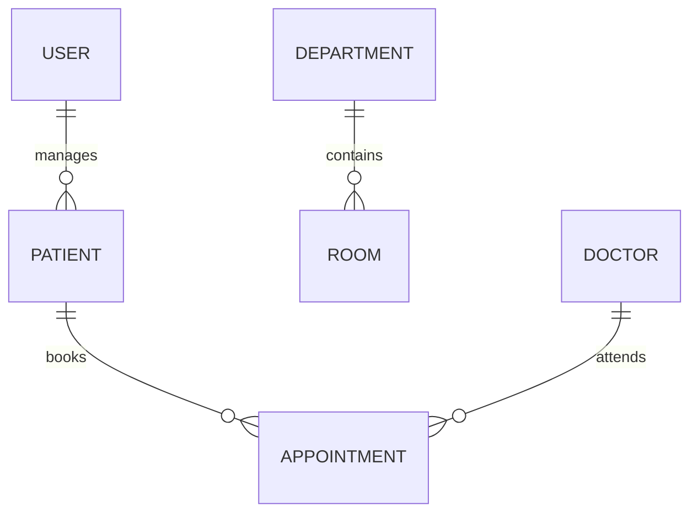

# Database Design

## Technology
- MySQL 8
- SQLAlchemy 2.0 async ORM
- In-memory repositories for many modules

## Schema
- Core tables defined in `backend/models/` and `database/schema.sql`.
- Module-level models in `backend/modules/*/models.py`.
- Migrations under `database/migrations/` are currently placeholders.

## Key Entities
- User, Patient, Department, Appointment, Prescription, and 100+ domain entities.

## ER Diagram (Simplified)

## Notes
- Many modules are not persisted to MySQL.
- Migration files are placeholders and require real Alembic migrations.
